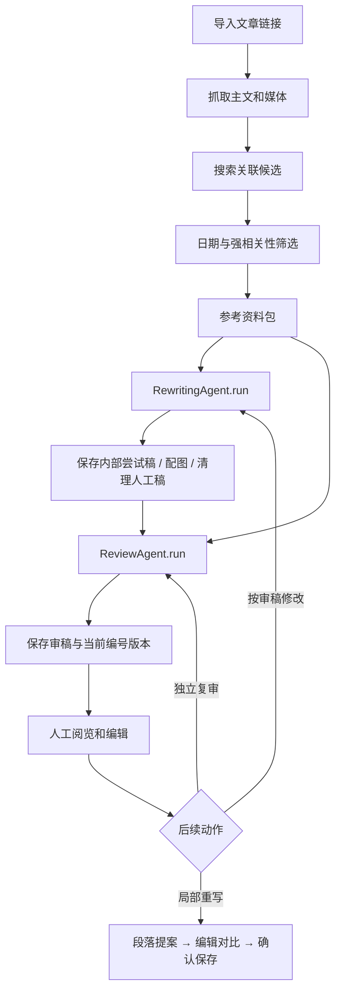

# 写作与审稿 Agent 的设计及代码位置

本文件说明实际调用链、输入输出和修改入口。当前两个 Agent 是由应用编排的两次独立 LLM 调用，不是自行循环、任意调用工具的自治程序。搜索、网页抓取、媒体下载、版本与任务互斥由 Python 业务模块执行。

本文件中的写作 Agent 对应项目所称的洗稿 Agent，实际类名为 RewritingAgent；审稿类名为 ReviewAgent。

## 一次完整创作

## 核心职责与入口

| 职责 | 代码 | 修改时需关注 |
| --- | --- | --- |
| HTTP 与任务入口 | backend/routes/generation.py、backend/tasks.py | 同一文章互斥，保存 revision 防止过期覆盖 |
| 总流程 | backend/workflow.py 的 ingest/run | 一次写作 + 一次审稿，失败保留当前稿与诊断 |
| 写作 Agent | backend/agents.py 的 RewritingAgent.run | Draft JSON 校验，字数容差与有限压缩重试 |
| 局部重写 | RewritingAgent.paragraph、routes/generation.py | 只生成选区提案；/paragraph/apply 才替换正文 |
| 审稿 Agent | backend/agents.py 的 ReviewAgent.run | 当前正文与 sources 核对，Review JSON 校验与明确的来源/长段复制检查 |
| 模型服务 | backend/agents.py 的 complete/provider_config | DeepSeek/OpenRouter、JSON 输出、独立参数与超时；密钥来自环境 |
| 关联资料 | backend/research_related.py、research_search.py、research_temporal.py | 默认 ±3 天；旧原论文/基础资料可作为背景；3–5 篇目标 |
| 主文与媒体 | backend/research.py、research_html.py、research_pdf.py、research_x.py、research_download.py | 原始文件、完整正文、媒体和每项质量报告 |
| 参考上下文 | backend/research_context.py | 保留标题、来源、日期；长文本分散采样，不能推断省略部分 |
| 多选区融合 | backend/reference_fusion.py、routes/references.py | 多来源正文融合，来源校验失败不插入 |
| 人工呈现 | backend/draft_presentation.py | 清除工作注释、脚注和正文出处；agent_evidence 保留内部核对稿 |
| 审稿缓存 | backend/review_state.py | 文案与证据指纹，保留旧审稿，只在变化后重新调用 |
| 编号版本 | backend/revisions.py、store.py | 累计 >30% 或明确另存；媒体不可变副本，与 revision 分开 |
| 公共素材 | backend/public_materials.py、routes/public_materials.py | 只把用户选择的公共资料加入本篇，不自动混入整个公共库 |
| GUI 交互 | web/features/editor/draft.js、rewrite-proposal.js、references.js | 阅览、提案对比、确认/窗外保存、资料浮窗 |

## 写作输入与输出

输入包括 sources（S1 起的来源编号、全文或采样片段、日期、采样警告）、options（篇幅/风格/平台/模型）、可用图片 Markdown、参考视频、previous_draft 和可选 feedback。返回 title、summary、keywords、body，经过 Pydantic 校验。

实际事实必须来自资料包，不能让模型声称做过未执行的实验或联网。写作 prompt 要求事实带来源编号，方便内部核对；生成的原始 JSON/Markdown 保存在 generated/attempts。必要时压缩并再次校验字数。配图优先使用相关来源素材，无可用图片时由本地排版生成文字信息图。

正文清理后保存供人工阅览的 body，内部有标注的稿另存 agent_evidence。当清理后正文哈希改变，旧标注稿不再作为当前正文的有效证据。参考来源列表独立显示，不进入组图或正文计数。

## 审稿输入与输出

审稿输入为当前 title/body、可用的 internal_evidence、来源包、素材和目标平台，返回 score、verdict、issues、strengths、fact_checks。issues 带 category/severity/detail/suggestion；fact_checks 带 claim/source_id/status/reason。系统再检查来源编号有效性和来源长段复制，保存 checked_at、draft_revision、fingerprint。

审稿结果是编辑辅助，不保证找出所有技术错误或平台/版权风险。无需人工稿显示脚注或来源编号；审稿应把明确事实对应到资料包。商业收入、营销数字、未经验证的性能等应作为来源作者声明核实，不能照抄为确定结论。

## Prompt 与参数

| 文件 | 用途 |
| --- | --- |
| config/prompts/rewriting.md | 原创结构、事实来源、图文与安全边界 |
| config/prompts/language-style.md | 栏目统一语言风格；调整方法见 prompt-style-guide.md |
| config/prompts/reviewing.md | 技术、出处、自然度、排版和风险标准 |
| config/prompts/fusion.md | 多段参考融合改写 |
| config/prompts/compression.md | 超长稿压缩并保留事实条件 |
| config/generation.json | 字数、风格、模型、两个 Agent 独立温度/Token/超时、图片数量与重试 |
| config/research.json | 搜索时间、候选/来源数量、正文预算与媒体下载上限 |
| config/platforms.json | 分页、卡片尺寸/字号和草稿媒体策略 |

每次完整生成保存 config-history 指纹快照。提示词调整后用同一组新闻样本比较，记录原句、期待输出和实际变化；不要只用审稿分数评估风格。

## 供你补充的设计逻辑

可直接在下面写你的目标与规则，再按上表定位实现。

- 写作结构与语言逻辑：
- 资料筛选和证据强度：
- 审稿优先级与扣分标准：
- 写作与审稿的反馈循环 / 最大次数：
- 人工确认、局部修改和版本规则：
- 固定测试样本与通过标准：
